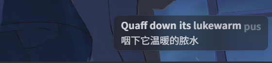
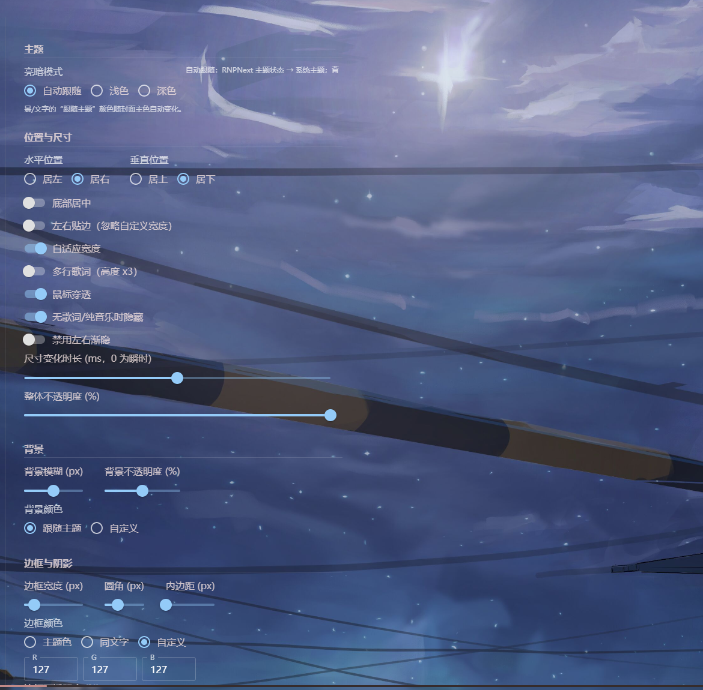
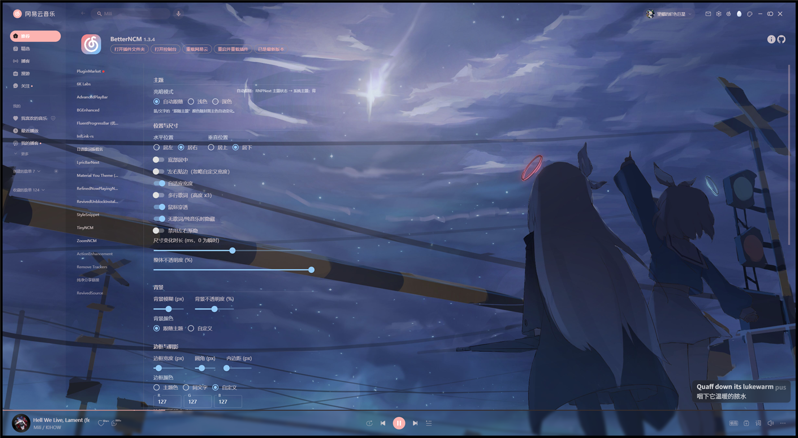

# LyricBarNext

重新设计的网易云音乐**软件内词栏**插件。由 [LyricBar](https://github.com/solstice23/lyric-bar-netease)（solstice23）与 [LyricBarBlur](https://github.com/Lukoning/LyricBarBlur)（Lukoning）合并而来，针对**网易云音乐 3.x** 重写适配，深度可定制、跟随主题，歌词来源可选。

当前版本：**1.1.9**（要求网易云 > 3.1.11，BetterNCM ≥ 1.0.0）

## 截图

软件内词栏（自适应宽度、逐字歌词、双语翻译，背景跟随封面主题色）：



设置面板（全部配置实时生效）：



运行于网易云音乐 3.1 主界面：



## 功能

- **逐字歌词**：与 RefinedNowPlayingNext 完全一致的动画时序（逐字高亮、上浮、间奏点）
- **歌词来源可选**：`自动`（RNPNext 优先、官方解析兜底）/ `RNPNext` / `官方解析`——官方来源使用网易云歌词 API + 内置 [liblyric](https://github.com/solstice23/liblyric) 解析器（逐行/翻译/罗马音/YRC 逐字），**不依赖 RNPNext 也可独立工作**
- **主题跟随**：亮暗模式自动跟随 RNPNext / 系统；背景与文字的"跟随主题"颜色走 RNPNext 的封面主色变量链，随封面与主题自动变化
- **深度定制**（全部实时生效）：
  - 位置与尺寸：水平/垂直位置、底部居中、左右贴边、自适应/固定宽度、**尺寸变化时长**（默认 500ms，与 2.x 一致）、多行高度、鼠标穿透、不透明度、无歌词隐藏、渐隐开关
  - 背景：模糊半径、不透明度、颜色（跟随主题/自定义）
  - 边框与阴影：宽度、圆角、内边距、颜色模式、完整 box-shadow 参数
  - 文字：字号、不透明度、颜色、描边（阴影/描边两种方式）、对齐
  - 歌词：翻译、罗马音、逐字开关、全局偏移（与 RNPNext 联动）、歌词来源
  - 字体：默认 / 跟随 RNPNext / 自定义 font-family
- **配置自动迁移**：首次运行自动继承旧 LyricBar（`lyric-bar-*`）与 LyricBarBlur（`LyricBarBlurSettings`）的配置
- **字体一致性**：配置界面自动继承网易云本体的计算字体
- **鲁棒性**：歌词偏移与字号的任何来源的非有限值自动归零；播放中进度事件失联 5 秒自动重绑 audioplayer 事件；切歌重挂载首帧瞬时就位（无飞入重叠）

## 性能设计

针对高刷新率与重负载页面的优化（详见 `src/`）：

- **行位移由 GPU 合成器插值**：行切换时 JS 仅单次写入目标 `transform`（`cubic-bezier(0.22,1,0.36,1)` 非线性缓出），主线程繁忙不影响动画帧率；同时覆盖 RNPNext 全局样式注入的同名类 transform 过渡，避免双重插值拖影
- **宽度解耦**：自适应宽度 + 左对齐时行宽为 `max-content`，词栏宽度动画不再引发全部行子树的逐帧重排
- **React 活动窗口**：`React.memo` 使行切换仅协调当前行 ±3 行；可见性差量写入，避免全子树样式重算
- **鲁棒性**：NaN 防护（偏移/字号任何来源的非有限值归零）、进度事件失联看门狗（播放中 5s 无事件自动重绑 `channel.registerCall`）、重挂载瞬时就位（加载首帧无飞入重叠）

## 构建

```bash
npm install
npm run build        # 产物在 dist/（webpack + babel + sass）
```

打包 `.plugin`（zip 格式，含 `manifest.json` + `main.js` + `preview.png`）：

```powershell
Compress-Archive -Path dist/manifest.json,dist/main.js,dist/preview.png -DestinationPath LyricBarNext.zip
Rename-Item LyricBarNext.zip LyricBarNext-<版本>.plugin
```

## 安装

1. 网易云音乐 **3.1.11+**，BetterNCM（含 II 分支）注入正常
2. 将 `LyricBarNext-<版本>.plugin` 放入 BetterNCM 插件目录（数据目录下 `plugins/`），重启网易云
3. RefinedNowPlayingNext **可选**：安装后歌词来源可用"自动/RNPNext"；不安装则选择"官方解析"即可
4. 建议停用旧版 LyricBar / LyricBarBlur（manifest 已声明互斥；旧配置会自动迁移）

## 来源与鸣谢

| 项目 | 作者 | 本项目中的使用 |
|---|---|---|
| [lyric-bar-netease](https://github.com/solstice23/lyric-bar-netease) | solstice23 | 词栏主体（MIT） |
| [LyricBarBlur](https://github.com/Lukoning/LyricBarBlur) | Lukoning | 外观定制配置项（MIT） |
| [refined-now-playing-netease-next](https://github.com/SUlTlUS/refined-now-playing-netease-next) | SUlTlUS / solstice23 | 3.x 兼容层、liblyric 解析器（MIT） |

歌词来源"官方解析"的数据来自网易云音乐官方歌词接口。

## 许可证

本程序以 **GPL-3.0-or-later**（GNU 通用公共许可证第 3 版或更高版本）授权，完整文本见 [`LICENSE`](./LICENSE)。

本程序包含改编自上述 MIT 许可项目的代码（词栏主体、外观配置逻辑、liblyric 解析器、3.x 兼容层），原作者保留其版权，此处随本程序以 GPL-3.0 重新分发，相应源文件头部已作标注。各上游项目在其各自仓库中仍以其原许可证发布。

## 目录结构

```
LyricBarNext/            # 插件工程
├── src/
│   ├── main.js          # 入口：挂载词栏、初始化外观/主题/歌词来源
│   ├── config.js        # 统一配置 + 旧配置迁移
│   ├── appearance.js    # 配置 → CSS 变量/状态类
│   ├── theme.js         # 亮暗检测（RNPNext 类/系统/强制）
│   ├── lyric-bar.js     # 词栏框架 + 拖拽调宽
│   ├── lyrics.js        # 歌词渲染、行定位、逐字动画
│   ├── lyric-source.js  # 歌词来源管理（RNPNext 桥接 / 官方解析 / 自动）
│   ├── liblyric.js      # liblyric 解析器 JS 移植（MIT）
│   ├── ncm-compat.js    # 3.x 兼容层（audioplayer 事件 / Redux store / 播放状态）
│   ├── settings.js      # 统一设置面板（MUI）
│   └── styles.scss      # 样式（CSS 变量体系）
├── manifest.json
└── webpack.config.js
tools/                   # BetterNCM PluginMarket 源修补脚本（商店维护用，与插件构建无关）
```

## 已知限制

- "自适应宽度 + 居中/右对齐"组合未做宽度解耦（仅左对齐默认配置解耦），该组合下尺寸变化的开销与 2.x 相当
- LyricBarBlur 中针对 2.x 悬浮底栏（`#main-player` / `.m-player-fm`）的 CSS 已随合并保留，在 3.x 下不匹配任何元素、无副作用
- 官方解析来源的歌词贡献者信息（作词/翻译署名）未展示
